

<picture><source media="(prefers-color-scheme: dark)" srcset="assets/hero-dark.svg"></picture>

<picture><source media="(prefers-color-scheme: dark)" srcset="assets/social-l-dark.svg"></picture><a href="https://t.me/relsev"><picture><source media="(prefers-color-scheme: dark)" srcset="assets/social-1-dark.svg"></picture></a><a href="https://discord.com/users/490411567620423680"><picture><source media="(prefers-color-scheme: dark)" srcset="assets/social-2-dark.svg"></picture></a><a href="https://www.donationalerts.com/r/relsev"><picture><source media="(prefers-color-scheme: dark)" srcset="assets/social-3-dark.svg"></picture></a><picture><source media="(prefers-color-scheme: dark)" srcset="assets/social-r-dark.svg"></picture>

<a href="https://github.com/Everelsu/Noctrinth"><picture><source media="(prefers-color-scheme: dark)" srcset="assets/project-noctrinth-dark.svg"></picture></a>&nbsp;<a href="https://github.com/Everelsu/Raspisanie"><picture><source media="(prefers-color-scheme: dark)" srcset="assets/project-raspisanie-dark.svg"></picture></a>

<a href="https://github.com/Everelsu/SpellBrigade"><picture><source media="(prefers-color-scheme: dark)" srcset="assets/project-spellbrigade-dark.svg"></picture></a>&nbsp;<a href="https://github.com/Everelsu/RelsevLink"><picture><source media="(prefers-color-scheme: dark)" srcset="assets/project-relsevlink-dark.svg"></picture></a>

<a href="https://github.com/Everelsu/steam-power-actions"><picture><source media="(prefers-color-scheme: dark)" srcset="assets/project-steam-power-actions-dark.svg"></picture></a>&nbsp;<a href="https://github.com/Everelsu/overlay-stopwatch"><picture><source media="(prefers-color-scheme: dark)" srcset="assets/project-overlay-stopwatch-dark.svg"></picture></a>

<picture><source media="(prefers-color-scheme: dark)" srcset="assets/stats-dark.svg"></picture>

<picture><source media="(prefers-color-scheme: dark)" srcset="assets/streak-dark.svg"></picture>

<picture><source media="(prefers-color-scheme: dark)" srcset="assets/wave-dark.svg"></picture>

<a href="https://everelsu.github.io/RelsevLink/"><picture><source media="(prefers-color-scheme: dark)" srcset="assets/button-1-dark.svg"></picture></a>&nbsp;&nbsp;<a href="https://github.com/Everelsu?tab=repositories"><picture><source media="(prefers-color-scheme: dark)" srcset="assets/button-2-dark.svg"></picture></a>

<a href="https://metawka.github.io/expressive-profile/?from=Everelsu"><picture><source media="(prefers-color-scheme: dark)" srcset="assets/credit-dark.svg"></picture></a>

